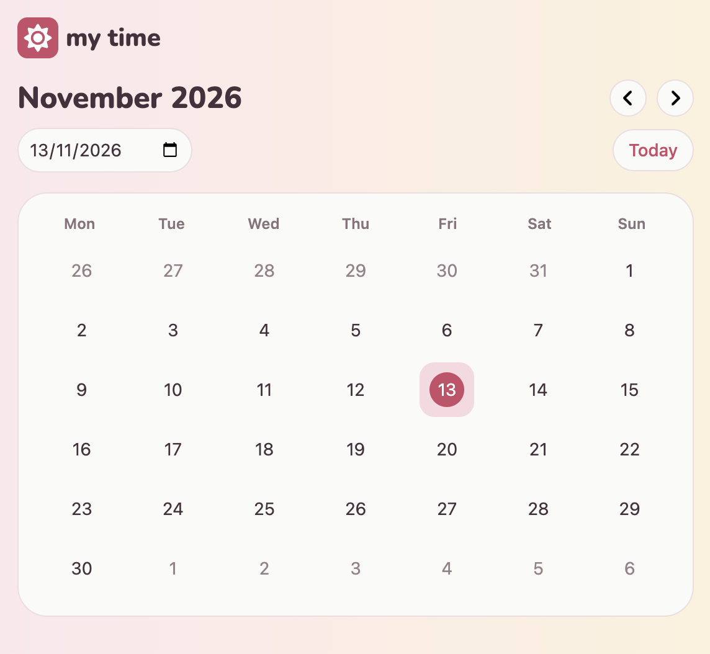

# Full-Stack Events calendar Application

**`IN PROGRESS`**

## Snippets

- **App Preview:**

<p align="center">

</p>

---

## Requirements / Purpose

### MVP & Purpose

This in progress application will be a full-stack event calendar planner designed to help users easily manage their schedules. Users can manage events and associated calendars through full CRUD (Create, Read, Update and Delete) operations.

### Tech Stack

- **Frontend:** React, TypeScript, React Testing Library, Storybook, Tailwind.
- **Backend (Planned):** Java, Spring Boot, Spring Data JPA, MySQL, OpenAPI/Swagger.
- **Testing & Tools (Planned):** Vitest, REST Assured, Maven, Git, GitHub Actions.

**Why this stack?**

- **TypeScript & Java:** Provides strong end-to-end type safety, reducing runtime errors across the stack.
- **Spring Boot:** Offers a robust, scalable backend framework with seamless database integration via JPA.

### Database Schema

**`TBC`**

---

## Build Steps

### Prerequisites

- Node.js (v18+) & npm

### Frontend Setup

1. Open a new terminal window and navigate to the frontend directory:

   ```bash
   cd frontend
   ```

2. Install dependencies:

   ```bash
   npm install
   ```

3. Run the development server:

   ```bash
   npm run dev
   ```

---

## Design Goals / Approach

- **Mobile-First Responsive Design:** Styled to prioritise clean layout and user experience on smaller screens before expanding to desktop views.
- **Component-Driven Architecture:** Built small, modular, reusable UI components (e.g. form fields, alerts, buttons) to keep page containers clean and readable.

---

## Features

- **Calendar Navigation:** Clear monthly calendar period navigation and date selection.

## Future Goals

- **Calendar Implementation:** Implement CRUD operations for managing custom calendars to have associated events
- **Event Implementation:** Implement CRUD operations for custom events
- **Authentication:** Create users entity and have users login to access only their own personal calendars and events
- **Calendar/Event sharing:** Enable sharing of events and/or calendars between multiple logged in users.

---

## Change Logs

**14/10/2026:** Frontend initial configuration

- Initial React/TypeScript frontend repository configuration.
- Added base `Header` UI component.

**16/10/2026:** Added core components with mocked data

- Added core `Calendar`, `DateCard` and `Button` components with mocked data.

**20/10/2026:** Dynamic calendar date fetching

- Utilised `date-fns` library and implemented dynamic date fetching for the calendar grid.

**22/10/2026:** Font Awesome, media query styling and additional calendar components

- Refactored existing component Tailwind styling including the addition of mobile-first media queries.
- Integrated Font Awesome for scalable UI icons.
- Reconfigured some of the Calendar JSX into new `CalendarControls` and `CalendarView` components.

**30/10/2026:** Restructured component architecture

- Created additional ui components.
- Extracted date calculation logic out of components and into `date-utils`.

**02/11/2026:** Error handling and Storybook

- Created `Alert` component.
- Added error handling to the date selection input.
- Configured Storybook and created initial ui component stories.

**03/11/2026:** Additional Storybook Stories

- Added additional Storybook stories for components and styling variations.

**05/11/2026:** Vitest testing configuration

- Added comprehensive unit testing for date utilities and core calendar components.

---

## Further details, related projects, reimplementations

- **Frontend Application: IN PROGRESS** React single-page application.
