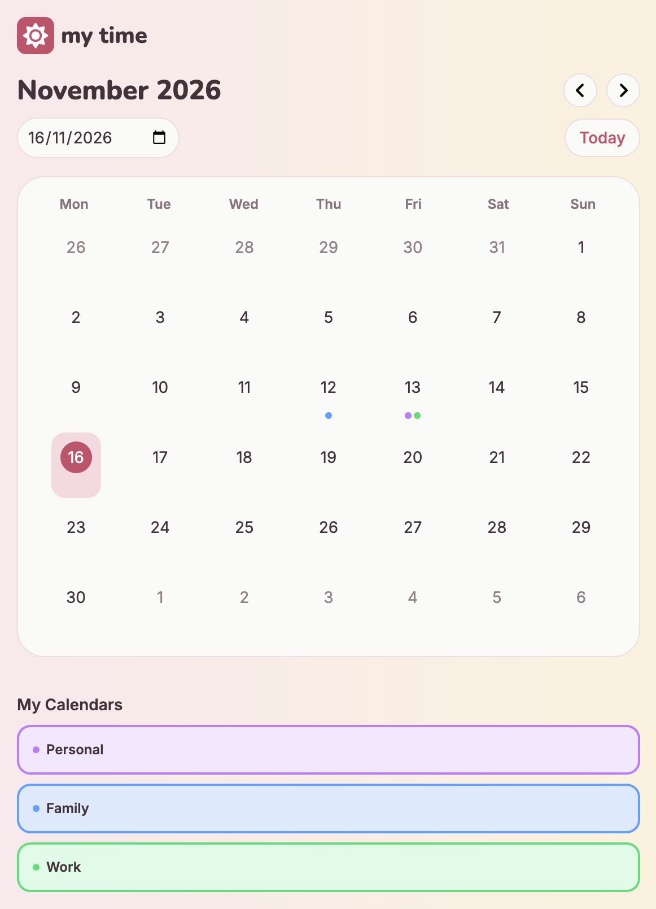
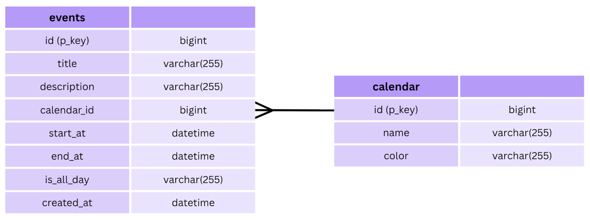

# Full-Stack Events calendar Application

**`IN PROGRESS`**

## Snippets

- **App Preview:**

<p align="center">

</p>

---

## Requirements / Purpose

### MVP & Purpose

This in-progress application will be a full-stack event calendar planner designed to help users easily manage their schedules. Users can manage events and associated calendars through full CRUD (Create, Read, Update and Delete) operations.

### Tech Stack

- **Frontend:** React, TypeScript, React Testing Library, Storybook, Tailwind.
- **Backend:** Java, Spring Boot, Spring Data JPA, MySQL, OpenAPI/Swagger.
- **Testing & Tools:** Vitest, REST Assured, Maven, Git, GitHub Actions.

**Why this stack?**

- **TypeScript & Java:** Provides strong end-to-end type safety, reducing runtime errors across the stack.
- **Spring Boot:** Offers a robust, scalable backend framework with seamless database integration via JPA.
- **React Query:** Simplifies asynchronous state management by handling cache invalidation and automatic refetching upon database mutations.

### Database Schema

<p align="center">

</p>

---

## Build Steps

### Prerequisites

- Java JDK 17+
- Node.js (v18+) & npm
- MySQL Server running locally

### Backend Setup

1. Navigate to the root directory:

   ```bash
   cd events-calendar
   ```

2. Build and run the Spring Boot application

   ```bash
   mvn spring-boot:run
   ```

3. Once the server is running, access the interactive Swagger API documentation and endpoint testing interface at: [http://localhost:8080/swagger-ui/index.html#/](http://localhost:8080/swagger-ui/index.html#/).

### Frontend Setup

1. Open a new terminal window and navigate to the frontend directory:

   ```bash
   cd frontend
   ```

2. Install dependencies:

   ```bash
   npm install
   ```

3. Run the development server:

   ```bash
   npm run dev
   ```

---

### Environment Variables

To run this application locally, you will need to set up the following environment variables. You can export them in your terminal, define them in your IDE run configuration, or store them in a `.env` file (if using a local environment loader).

| Variable         | Description                  | Example / Default       |
| :--------------- | :--------------------------- | :---------------------- |
| `DB_HOST`        | Database host address        | `localhost`             |
| `DB_PORT`        | Database port number         | `3306` (MySQL)          |
| `DB_USER`        | Database connection username | `root`                  |
| `DB_PASSWORD`    | Database connection password | `your_secure_password`  |
| `DB_NAME`        | Name of the database         | `event_db`              |
| `SPRING_PROFILE` | Active Spring profile        | `dev` / `prod` / `test` |

### Example `.env` file

```env
DB_HOST=localhost
DB_PORT=3306
DB_USER=root
DB_PASSWORD=secret
DB_NAME=event_db
SPRING_PROFILE=dev
```

### Frontend Environment Variables

Additionally inside the frontend directory an additional .env file is needed to connect to the backend:

| Variable       | Description          | Example / Default       |
| :------------- | :------------------- | :---------------------- |
| `VITE_API_URL` | Backend host address | `http://localhost:8080` |

#### Example `.env` file

```env
VITE_API_URL=http://localhost:8080
```

---

## Design Goals / Approach

- **Mobile-First Responsive Design:** Styled to prioritise clean layout and user experience on smaller screens before expanding to desktop views.
- **Component-Driven Architecture:** Built small, modular, reusable UI components (e.g. form fields, alerts, buttons) to keep page containers clean and readable.
- **Clear State Visualisation:** Clear state messaging so users are clear of the status of any requests to the backend.
- **RESTful Endpoint Design:** Structured resources (`/events`, `/calendars`) following REST conventions.

---

## Features

- **Calendar Navigation:** Clear monthly calendar period navigation and date selection.
- **Event Management (IN PROGRESS):** Create, view, update, and delete events.
- **Calendar Management (IN PROGRESS):** Create, view, update, and delete custom calendars.

## Future Goals

- **Calendar Implementation:** Implement CRUD operations for managing custom calendars to have associated events
- **Event Implementation:** Implement CRUD operations for custom events
- **Authentication:** Create users entity and have users login to access only their own personal calendars and events
- **Calendar/Event sharing:** Enable sharing of events and/or calendars between multiple logged in users.

---

## Change Logs

**14/10/2026:** Frontend initial configuration

- Initial React/TypeScript frontend repository configuration.
- Added base `Header` UI component.

**16/10/2026:** Added core components with mocked data

- Added core `Calendar`, `DateCard` and `Button` components with mocked data.

**20/10/2026:** Dynamic calendar date fetching

- Utilised `date-fns` library and implemented dynamic date fetching for the calendar grid.

**22/10/2026:** Font Awesome, media query styling and additional calendar components

- Refactored existing component Tailwind styling including the addition of mobile-first media queries.
- Integrated Font Awesome for scalable UI icons.
- Reconfigured some of the Calendar JSX into new `CalendarControls` and `CalendarView` components.

**30/10/2026:** Restructured component architecture

- Created additional ui components.
- Extracted date calculation logic out of components and into `date-utils`.

**02/11/2026:** Error handling and Storybook

- Created `Alert` component.
- Added error handling to the date selection input.
- Configured Storybook and created initial ui component stories.

**03/11/2026:** Additional Storybook Stories

- Added additional Storybook stories for components and styling variations.

**05/11/2026:** Vitest testing configuration

- Added comprehensive unit testing for date utilities and core calendar components.

**07/11/2026:** Events and custom calendars in frontend

- Added event and calendars components to the frontend with dummy data

**12/11/2026:** Backend set up and both event and calendar features initial set up and endpoints

- Configured backend set up
- Implemented calendar feature API and getAllCalendars endpoint
- Implemented event feature API and getAllEvents endpoint

**13/11/2026:** Consume getAllCalendars endpoint

- Consumed getAllCalendars endpoint in frontend with state handling and tests

**16/11/2026:** Consume getAllEvents endpoint, Swagger configuration

- Consumed getAllEvents endpoint in frontend with state handling and tests
- Configured Swagger documentation
- Added `created_at` column to events entity, to enable easier future reporting, database updates and debugging

---

## Further details, related projects, reimplementations

- **Backend API (IN PROGRESS):** Spring Boot REST API serving endpoints at `/events` and `/calendars`.
- **Frontend Application (IN PROGRESS):** React single-page application.

```

```
